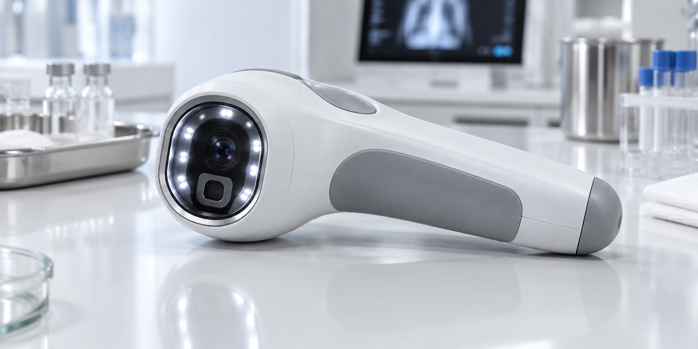

<div align="center">
  
</div>

<p align="center">
  <a href="https://diufoundry.online"></a>&nbsp;
  &nbsp;
  
</p>

# Diumed

**An experimental mobile health-interface prototype exploring on-device vision workflows and accessible health-related interactions.**

---

### The Problem
This project explores how a mobile-first interface might support health-related workflows in settings with limited connectivity. The current repository should be treated as a software prototype, not as a validated clinical measurement system or a substitute for medical instruments.

### The Solution
The codebase includes Capacitor and MediaPipe vision dependencies that can support camera and on-device vision experiments. Do not interpret any visual output as a clinically validated vital sign, diagnosis, or triage recommendation. Offline operation and data flow should be verified in the actual build before being represented as guaranteed behaviour.

---

### Core Architecture

- **Vision experiments:** `@mediapipe/tasks-vision` is included for computer-vision exploration; its presence alone does not establish medically accurate measurement.
- **Mobile integration:** Capacitor dependencies provide a foundation for native mobile integrations; confirm each device API is implemented and tested before relying on it.
- **Accessibility exploration:** Text-to-speech can support spoken interface feedback when correctly integrated; it should not be presented as validated medical guidance.
- **Data boundary:** Supabase is present as an application integration dependency. This README does not claim HIPAA compliance, end-to-end encryption, or a validated patient-record security model.

---

### Safety, privacy, and prototype status

**Not a medical device. Not validated for diagnosis, monitoring, or treatment.** Do not use the application or its outputs to make clinical decisions, and do not enter real patient or biometric information into an unreviewed development deployment. Before any real-world health use, the project would need independent clinical validation, security testing, consent and privacy review, and jurisdiction-specific regulatory/compliance assessment.

### Quick Start

```bash
git clone https://github.com/Kishordiu/diumedtest1.git
cd diumedtest1

npm install
npm run dev

# Android native build
npx cap sync android
npx cap open android
```

---

<p align="center">
  <sub>Experimental health-interface prototype by <a href="https://diufoundry.online">DIU FOUNDRY</a></sub>
</p>
